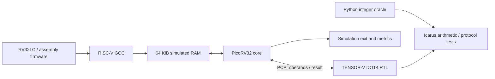

# TENSOR-V

A laptop-runnable hardware/software co-design project: a signed INT8 dot-product
accelerator attached to a simulated PicoRV32 RISC-V processor.

**Current milestone: working RTL, bare-metal firmware, verification, and a kernel
benchmark.** The handwritten-digit neural network is the next milestone and is
not implemented yet.

## Run on this laptop

From PowerShell in this project:

```powershell
.\tensorv.ps1
.\tensorv.ps1 benchmark
.\tensorv.ps1 synth
```

The launcher uses the existing Ubuntu WSL installation. If PowerShell execution
policy prevents running a script, the equivalent command is `wsl -d Ubuntu -- make all`.
The tools were installed and these targets were tested on this laptop.

From Ubuntu/WSL, change to this project directory and use:

```bash
make all         # arithmetic tests, processor tests, then measured kernel benchmark
make unit       # 272,193 independent golden vectors + protocol tests
make smoke      # RV32I firmware, with and without memory stalls
make benchmark  # JSON report at build/benchmark.json
make synth      # standalone DOT4 synthesis report at build/synthesis.log
make tools      # installed tool versions
```

For a fresh Ubuntu installation, run `bash scripts/setup-ubuntu.sh` first. This
installs system packages using sudo. Normal builds run as your regular WSL user.
Python verification uses only the standard library. Cocotb and ML dependencies
have not been installed yet.

Verilator's generated Makefiles cannot build under a path containing spaces.
The build script handles `AI Project` by compiling a temporary copy of the sources
under `/tmp` and copying the executable back to `build/sim/`. Your source files
stay in this project. Build artifacts and the unrelated existing `tmp/` directory
are excluded from Git.

## Architecture



The processor and DOT4 unit execute as a Verilator model. RAM and the report/exit
devices are modeled in C++. This is a hardware simulation, with no FPGA required.

`dot4 rd, rs1, rs2` treats both source registers as four signed bytes, multiplies
corresponding lanes, and returns their exact sum as a signed 32-bit integer:

```text
rd = sum(signed_byte(rs1, i) * signed_byte(rs2, i), i = 0..3)
```

The least significant byte is lane zero. The instruction uses the `custom-0`
opcode (`0x0b`), with `funct3 = 0` and `funct7 = 0`. The hardware has four signed
8-bit multipliers and an 18-bit reduction, followed by a registered result.
See [the architecture contract](docs/architecture.md) for timing and memory details.

## Verified first results

Measured on September 6, 2026, using the checked-in firmware and pinned PicoRV32:

| 256 packed dot products | Scalar RV32I | TENSOR-V DOT4 |
|---|---:|---:|
| Simulated cycles in measured window | 566,670 | 8,979 |
| Instructions in measured window | 139,155 | 2,052 |
| Output checksum | 265,865 | 265,865 |

This is **63.11x fewer cycles for this kernel relative to software multiplication**.
PicoRV32's hardware multiply/divide units are disabled. GCC lowers scalar multiply
to its RV32I library routine. These numbers include loop, load, call, and counter
overheads, and do not represent complete neural-network speedup. The simple
scalar reference has not been tuned; an optimized scalar baseline and an RV32IM
hardware-multiply comparison remain future work. No clock frequency, energy,
silicon area, FPGA performance, or inference accuracy is claimed.

All 272,193 golden arithmetic vectors passed. The processor also passed baseline
execution, correct exception behavior for unsupported instructions, and a run
with one memory completion opportunity every four cycles. Yosys synthesizes the
standalone accelerator to 2,023 generic cells; that is a technology-independent
logic count, not an FPGA LUT count or physical area. See [validation](docs/validation.md).

## Project map

| Path | Purpose |
|---|---|
| `rtl/tensorv_dot4.sv` | Original accelerator RTL |
| `rtl/tensorv_soc.sv` | PicoRV32 / PCPI integration |
| `firmware/` | Boot code, linker layout, custom-instruction wrapper, tests and kernel |
| `sim/main.cpp` | Cycle simulation, RAM, memory delays, completion and error handling |
| `tests/` | Independent Python oracle and SystemVerilog unit test |
| `scripts/` | Setup, portable build, benchmark report generation |
| `third_party/picorv32/` | Unmodified, pinned upstream core and ISC license |
| `docs/` | Architecture, verified status, and next milestones |
| `build/` | Generated binaries, disassembly, logs, vectors, and benchmark JSON |

## Next milestone

Train a reproducible `64 -> 16 -> 10` MLP on sklearn's 8x8 digits dataset, using a
fixed train/validation/test split. Quantize weights and activations to INT8,
export an integer reference and firmware data, then compare scalar and DOT4
inference on the same held-out samples. Quantization scales, rounding, saturation,
and bias widths must be specified before using accuracy or speedup in a resume.

See [the roadmap](docs/roadmap.md) for the remaining work.

## Attribution

The base CPU is [PicoRV32 by Clifford Wolf and contributors](https://github.com/YosysHQ/picorv32),
used under the included ISC license. TENSOR-V's contribution is the external
accelerator, integration, firmware, tests, and evaluation workflow. The original
core is not represented as a new processor design. Its exact source version and
checksum are recorded in [UPSTREAM.md](third_party/picorv32/UPSTREAM.md).

Primary interface references:
[PicoRV32 PCPI](https://github.com/YosysHQ/picorv32#pico-co-processor-interface-pcpi)
and [RISC-V instruction encodings](https://docs.riscv.org/reference/isa/unpriv/rv-32-64g.html).
